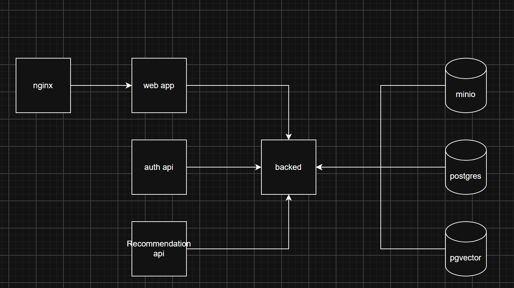

# Dvizh

Запуск всего проекта из корня:

```shell
docker compose up --build
```

Сайт: **http://localhost:8080**. 

Для карты места события и подсказок адреса заполните ключи Яндекса в `.env`:
[подключение Яндекс Карт](docs/yandex-maps.md). Дальше используется та же команда запуска.

API изображений, черновиков и уведомлений: [MEDIA_LIFECYCLE_API.md](backend/MEDIA_LIFECYCLE_API.md).

Основной пользовательский API: [профиль, личные списки и приглашения](backend/PERSONAL_API.md).



## Сервисы

- `nginx` — публичная входная точка;
- `web-app` — React-фронтенд; в Docker его отдаёт nginx, он же перенаправляет
  `/api` в backend;
- `backend` — основной FastAPI API;
- `auth-api` — внутренний FastAPI-сервис аутентификации;
- [recommendation-service](recommendation-service/README.md) — отдельный gRPC-сервис рекомендаций;
- `postgres` — основная реляционная база;
- `pgvector` — отдельный PostgreSQL с расширением pgvector;
- `database-init` — подготовка роли рекомендаций и схемы pgvector перед запуском API;
- `minio` — S3-совместимое файловое хранилище;
- `minio-init` — одноразовый контейнер для создания bucket в MinIO.

## Структура

Имя каждого каталога совпадает с именем сервиса в `compose.yaml`, а его
`Dockerfile` находится в корне каталога:

```text
auth-api/
backend/
database-init/
minio/
minio-init/
nginx/
pgvector/
postgres/
recommendation-service/
web-app/
```

Python-сервисы `auth-api`, `backend` и `recommendation-service` имеют
одинаковый production-oriented layout:

```text
service/
├── src/
│   └── package/
│       ├── __init__.py
│       ├── config.py
│       └── main.py
├── tests/
├── .dockerignore
├── Dockerfile
├── pyproject.toml
└── uv.lock
```

Зависимости фиксируются отдельным `uv.lock` для каждого сервиса. Docker-образы
собираются в два этапа, устанавливают пакет в non-editable режиме и запускаются
от непривилегированного пользователя без uv и исходников в runtime-слое.

Фронтенд `web-app` — React + TypeScript + Vite + Tailwind CSS:

```text
web-app/
├── src/
│   ├── api/          # запросы к backend (/api/...)
│   ├── app/          # роутинг и текущий пользователь
│   ├── components/
│   │   ├── ui/       # базовые компоненты: Button, Input, Tag, Toggle…
│   │   ├── widgets/  # шапка, карточка события, лента, фильтры, календарь
│   │   ├── layouts/
│   │   └── pages/    # афиша, событие, создание события, календарь, профиль, вход
│   ├── hooks/
│   ├── models/       # типы, повторяющие DTO backend
│   ├── styles/       # дизайн-токены и глобальные стили
│   └── utils/
├── public/
├── nginx.conf        # раздача сборки и прокси /api в backend
├── Dockerfile
├── package.json
└── vite.config.ts
```

Docker-образ `web-app` собирается в два этапа: на Node собирается фронтенд,
а в runtime-слое остаётся только непривилегированный nginx со статикой.

Запрос проходит по цепочке `Nginx → web-app → backend`. Recommendation-service,
backend и хранилища доступны только внутри сети Compose.

## Запуск

Как запустить проект в Docker, открыть Swagger и работать с сервисами локально,
описано в [RUNNING.md](RUNNING.md).

## README отдельных компонентов

- [Сервис рекомендаций](recommendation-service/README.md) — устройство сервиса, gRPC-контракт, запуск и тестирование.
- [pgvector](pgvector/README.md) — назначение векторной БД, схема хранения и настройка.
- [Alembic сервиса аутентификации](auth-api/alembic/README) — краткая справка об окружении миграций.
- [Роли аккаунтов](docs/roles.md) — роли `user`/`admin` и начальный аккаунт администратора.

