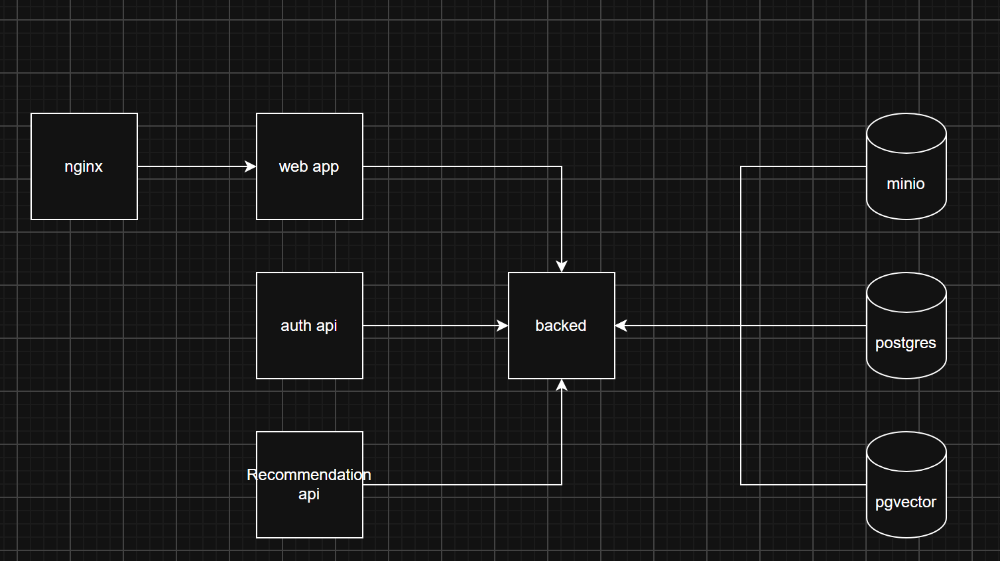

# Dvizh



## Сервисы

- `nginx` — публичная входная точка;
- `web-app` — FastAPI-сервис, который отдаёт собранный React-фронтенд
  (`web-app/frontend`) и перенаправляет `/api` в backend;
- `backend` — основной FastAPI API;
- `auth-api` — внутренний FastAPI-сервис аутентификации;
- [recommendation-service](recommendation-service/README.md) — отдельный gRPC-сервис рекомендаций;
- `postgres` — основная реляционная база;
- `pgvector` — отдельный PostgreSQL с расширением pgvector;
- `minio` — S3-совместимое файловое хранилище;
- `minio-init` — одноразовый контейнер для создания bucket в MinIO.

## Структура

Имя каждого каталога совпадает с именем сервиса в `compose.yaml`, а его
`Dockerfile` находится в корне каталога:

```text
auth-api/
backend/
minio/
minio-init/
nginx/
pgvector/
postgres/
recommendation-service/
web-app/
```

Python-сервисы `auth-api`, `backend`, `recommendation-service` и `web-app` имеют
одинаковый production-oriented layout:

```text
service/
├── src/
│   └── package/
│       ├── __init__.py
│       ├── config.py
│       └── main.py
├── tests/
├── .dockerignore
├── Dockerfile
├── pyproject.toml
└── uv.lock
```

Зависимости фиксируются отдельным `uv.lock` для каждого сервиса. Docker-образы
собираются в два этапа, устанавливают пакет в non-editable режиме и запускаются
от непривилегированного пользователя без uv и исходников в runtime-слое.

Фронтенд — React + TypeScript + Vite + Tailwind CSS в `web-app/frontend`:

```text
web-app/frontend/src/
├── api/          # запросы к backend (/api/...)
├── app/          # роутинг и текущий пользователь
├── components/
│   ├── ui/       # базовые компоненты: Button, Input, Tag, Toggle…
│   ├── widgets/  # шапка, карточка события, лента, фильтры, календарь
│   ├── layouts/
│   └── pages/    # афиша, событие, создание события, календарь, профиль, вход
├── hooks/
├── models/       # типы, повторяющие DTO backend
├── styles/       # дизайн-токены и глобальные стили
└── utils/
```

Docker-образ `web-app` собирает фронтенд отдельным этапом на Node и кладёт
результат в `dvizh_web/static`; в runtime-слое Node нет.

Запрос проходит по цепочке `Nginx → web-app → backend`. Recommendation-service,
backend и хранилища доступны только внутри сети Compose.

## Запуск

Как запустить проект в Docker, открыть Swagger и работать с сервисами локально,
описано в [RUNNING.md](RUNNING.md).
