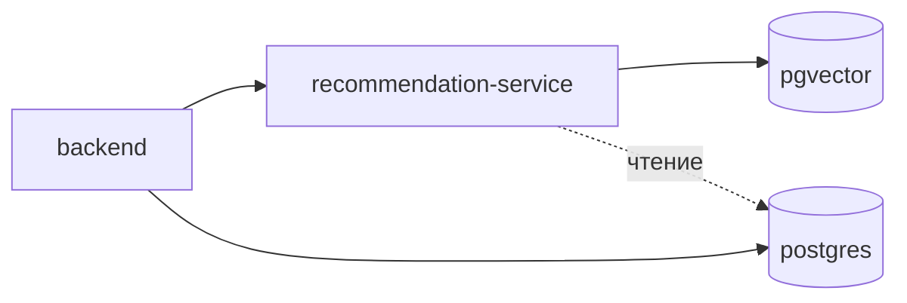
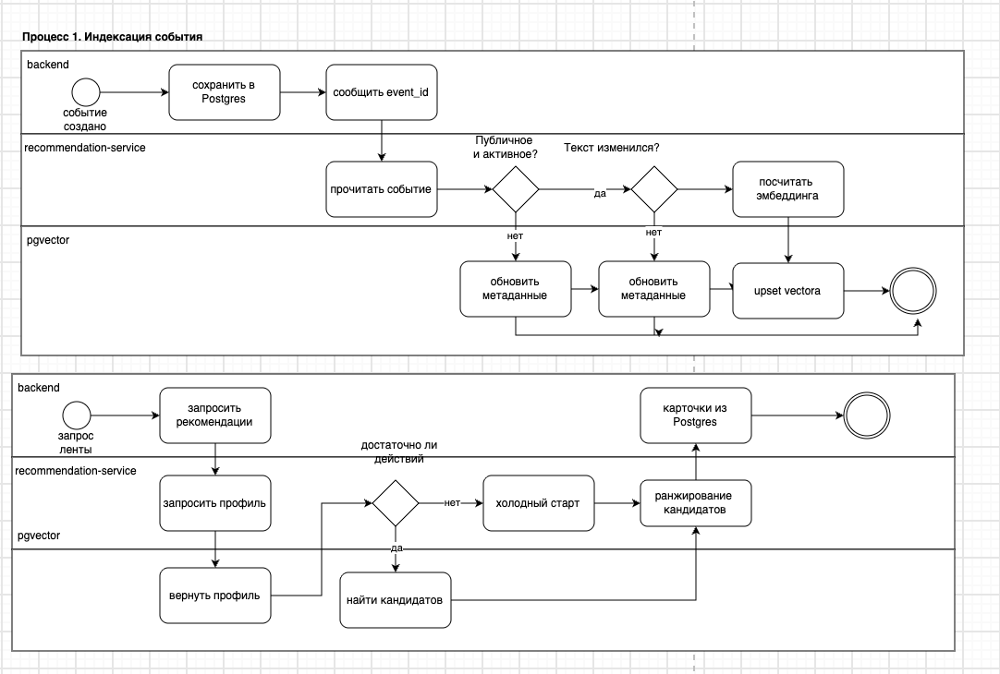

# pgvector

Отдельный PostgreSQL с расширением [pgvector](https://github.com/pgvector/pgvector). Хранит эмбеддинги событий и позволяет быстро находить события, близкие по смыслу к интересам пользователя. На этом строится персональная выдача афиши.

## Назначение и границы

Эмбеддинг превращает текст события в вектор из 384 чисел: близкие по смыслу события получают близкие векторы. Это позволяет искать похожие события без ручных категорий.

- Основная БД `postgres` остаётся источником истины. В `pgvector` лежат только производные данные, которые можно пересчитать.
- Связь с `postgres` идёт по `event_id` (внешних ключей между базами нет).
- Писать в `pgvector` может только `recommendation-service`.
- Тексты карточек, пользователи и история действий здесь не хранятся.

| Входит | Не входит |
|---|---|
| Образ, запуск и настройка БД | Расчёт эмбеддингов (`recommendation-service`) |
| Схема таблиц и индексы | Итоговое ранжирование ленты (`recommendation-service`) |
| Допустимые запросы | Карточки и тексты событий (`postgres`) |

## Место в архитектуре



Порт `pgvector` наружу не публикуется, база доступна только внутри сети docker compose.



## Структура каталога

```
pgvector/
├── Dockerfile      # образ на базе pgvector/pgvector
├── .dockerignore
├── init.sql        # расширение, таблицы и индексы
├── README.md       # вход в документацию
└── docs/
    └── README.md   # описание и эксплуатация
```

`init.sql` выполняется на новом volume при первом старте базы. Сервис
`pgvector-init` применяет тот же скрипт на новых и существующих volumes.

## Быстрый старт

```shell
docker compose up -d --build pgvector-init
docker compose ps pgvector          # статус должен быть healthy
```

Проверка, что расширение и таблица созданы:

```shell
docker compose exec pgvector psql -U dvizh -d dvizh_vectors -c "\dx"
docker compose exec pgvector psql -U dvizh -d dvizh_vectors -c "\d event_embeddings"
```

В списке расширений должен быть `vector`.

## Конфигурация

Переменные из `.env` (значения по умолчанию заданы в `compose.yaml`):

| Переменная | По умолчанию | Назначение |
|---|---|---|
| `VECTOR_DB` | `dvizh_vectors` | имя базы |
| `VECTOR_USER` | `dvizh` | пользователь |
| `VECTOR_PASSWORD` | `change-me` | пароль (замените в `.env`) |

## Модель данных

Текущая схема использует векторы размерности **384** и косинусное расстояние.

### `event_embeddings`

В каждой опубликованной ревизии одна строка на мероприятие. Первичный ключ состоит
из `model_name` и `event_id`.

| Поле | Откуда в `postgres` | Зачем |
|---|---|---|
| `event_id` | `events.id` | связь с основной БД |
| `embedding` | считается из текста события | поиск по смыслу |
| `model_name`, `content_hash` | служебные | ключ опубликованной ревизии и хэш источника вектора |
| `is_candidate` | `status = PUBLISHED`, `visibility = PUBLIC`, не удалено | попадает ли событие в поиск |
| `next_starts_at`, `last_ends_at` | `event_occurrences` | фильтр по времени |
| `price_type`, `format` | `events` | фильтры |
| `city`, `latitude`, `longitude` | `locations` | география |
| `topic_ids` | `event_tags` | тематики мероприятия |
| `source_updated_at` | `recsys_catalog` | время обновления исходных данных |

### Остальные таблицы

- `embedding_index_versions` связывает опубликованные ревизии с версиями энкодера.
- `user_embeddings` хранит векторы пользователей для каждой ревизии.
- `recommendation_pages` хранит журнал выдач и рассчитанные признаки.

### Что в `pgvector` не хранится

- названия, описания и другие тексты карточек;
- персональные данные и история действий пользователей;
- быстро меняющиеся счётчики (сколько идёт, сколько сохранили);
- неопубликованные, приватные и удалённые события (`is_candidate = false`, либо строки нет).

## Индексы

| Индекс | Тип | Для чего |
|---|---|---|
| `event_embeddings_hnsw_*` | HNSW по `embedding`, косинусное расстояние | поиск в конкретной ревизии |
| `event_embeddings_dates_idx` | B-tree по `last_ends_at` | отбор по времени |
| `event_embeddings_topics_gin` | GIN по `topic_ids` | фильтр по тематикам |

HNSW ищет приближённо: быстрее полного перебора, но может изредка пропустить подходящий результат. При небольшом числе событий (до нескольких тысяч) точный перебор тоже достаточно быстр.

## Публикация векторов

Сервис публикует новый неизменяемый набор через [команду индексации RecSys](../../recommendation-service/docs/README.md#pgvector).
Открытые сессии продолжают использовать прежний набор. Доступность мероприятий
проверяется по каталогу Backend перед выдачей.

## Быстрая проверка

Данные из `postgres` для этого не нужны.

### 1. Проверка за минуту (без модели)

Три события с вручную заданными векторами. Тестовые записи откатываются в конце транзакции.

```shell
docker compose exec -T pgvector psql -U dvizh -d dvizh_vectors <<'SQL'
BEGIN;

-- вектор из первых координат, остальные нули (всего 384)
CREATE FUNCTION pg_temp.v(head float8[]) RETURNS vector AS $$
  SELECT array_cat(head, array_fill(0::float8, ARRAY[384 - cardinality(head)]))::vector
$$ LANGUAGE sql;

INSERT INTO event_embeddings
    (event_id, embedding, model_name, content_hash, is_candidate, last_ends_at, source_updated_at)
VALUES
    ('00000000-0000-0000-0000-000000000001', pg_temp.v('{1,0.1}'), 'test', 'x', true,  now() + interval '7 days', now()),
    ('00000000-0000-0000-0000-000000000002', pg_temp.v('{0,1}'),   'test', 'x', true,  now() + interval '7 days', now()),
    ('00000000-0000-0000-0000-000000000003', pg_temp.v('{1,0}'),   'test', 'x', false, now() + interval '7 days', now());

SELECT event_id, round((1 - (embedding <=> pg_temp.v('{1,0}')))::numeric, 3) AS similarity
FROM event_embeddings
WHERE model_name = 'test' AND is_candidate AND last_ends_at > now()
ORDER BY embedding <=> pg_temp.v('{1,0}')
LIMIT 3;

ROLLBACK;
SQL
```

Ожидаемый результат: две строки, первой идёт `...0001` (similarity около 0.995), второй `...0002` (0.000). Событие `...0003` не попало в выдачу, потому что `is_candidate = false`.

Публикацию ревизий и выдачу проверяет [интеграционный тест RecSys](../../recommendation-service/tests/test_vector_index_integration.py).

## Обновление схемы

Для применения обновлённого `init.sql` запустите подготовку базы повторно:

```shell
docker compose run --rm --build pgvector-init
```

## Типичные проблемы

| Симптом | Причина и решение |
|---|---|
| Изменил `init.sql`, ничего не поменялось | Пересоберите и запустите `pgvector-init`, см. «Обновление схемы». |
| `different vector dimensions` | Размерность вектора не равна 384: проверьте модель и колонку. |
